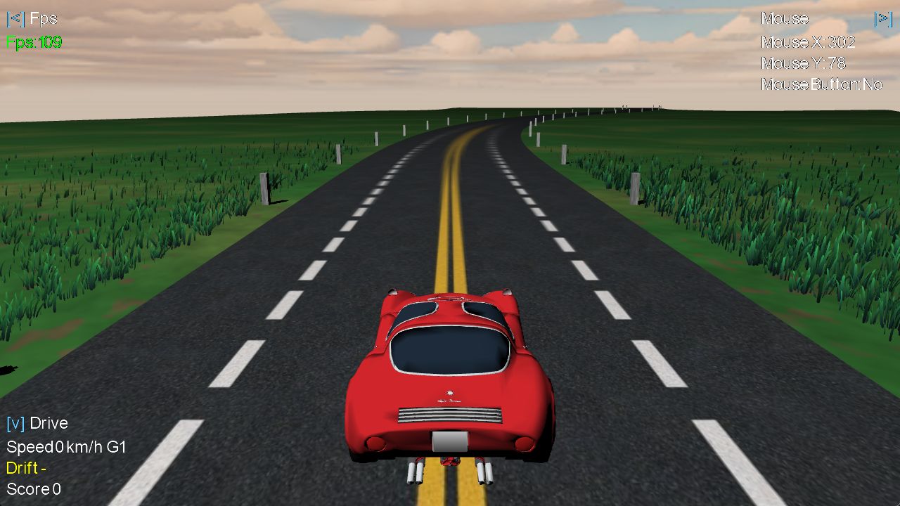
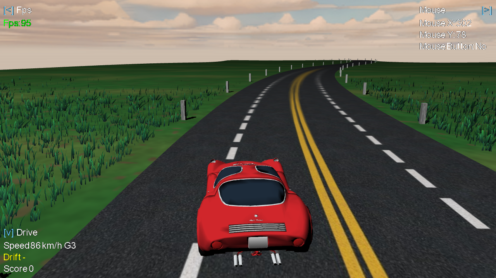
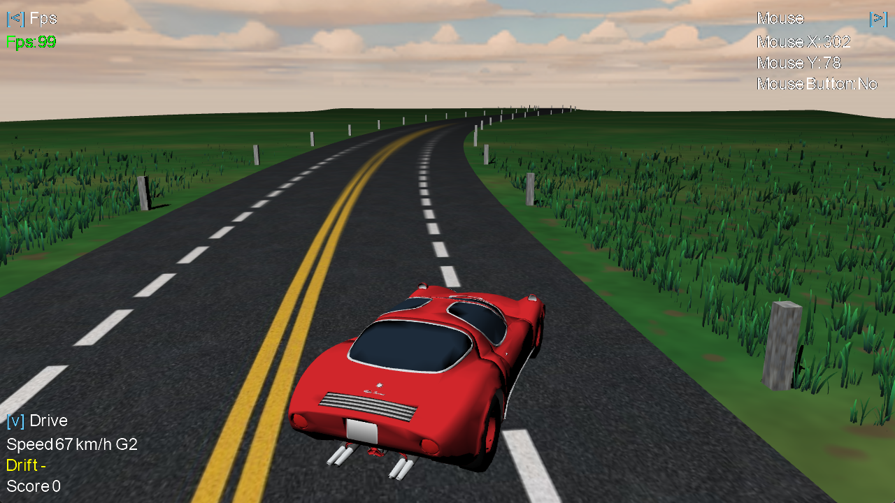
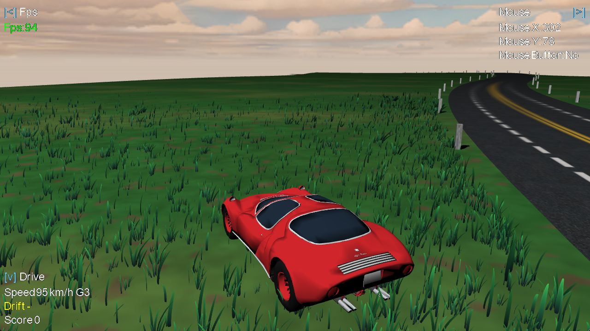

# Mark_1_DX3D — Drift Horizon

A small DirectX 11 engine written from scratch in C++ (building on the Rastertek DX11 tutorials), and the car game
built on top of it: **Drift Horizon**, an endless winding road, a rear-wheel-drive car with a slip-angle tyre model,
and a drift score.



## The game

You drive a red Alfa Romeo 33 Stradale along a procedurally generated road that never ends. The road is generated
ahead of the car and forgotten behind it, with gradual hills, banks and dips in the land beside it.

| | |
|---|---|
|  |  |
| Taking a bend at 86 km/h (3rd gear). | The rear stepping out under the handbrake. |



*Leave the tarmac and the tyres lose grip; the grass sways in the wind.*

### Controls

| Key | Action |
|---|---|
| `W` | Throttle |
| `S` | Brake |
| `A` / `D` | Steer left / right |
| `Space` | Handbrake (kicks the rear out to start a drift) |
| `R` | Restart the run |
| `F11` | Toggle windowed / fullscreen |

The HUD shows speed, gear, drift state and score at the bottom left, plus FPS and mouse info in the corners.
The HUD widgets can be minimised with the small arrow buttons.

### What is in the game

- **Car physics.** The car is a rigid body (the `Physics` module, ported from a separate physics framework). Nothing
  "follows" the road: the engine pushes, the brakes pull, and two tyres turn the car's motion into forces using a
  slip-angle tyre model. When a tyre runs out of grip the car drifts. There is an engine torque curve, a 6-speed
  automatic gearbox, weight transfer under braking and acceleration, and off-road friction loss.
  All tuning values are `static const` at the top of [`Car.cpp`](Mark_1_DX3D/Game/Source/Car.cpp).
- **Drift scoring.** Points come from the slip angle of the car scaled by speed, chained into a combo with a growing
  multiplier. A chain is banked after a short grace period; hitting a wall or leaving the road loses the running
  chain. See [`DriftScore.h`](Mark_1_DX3D/Game/Include/DriftScore.h).
- **Endless road.** [`Road`](Mark_1_DX3D/Game/Include/Road.h) is a centre line of points generated on demand; the
  road and ground meshes are rebuilt as the car advances.
- **Fence posts.** Posts beside the road stay still until the car hits them, then become physics rigid bodies that
  fly off, bounce and settle ([`Fence.h`](Mark_1_DX3D/Game/Include/Fence.h)).
- **Wind-animated grass.** Instanced, alpha cut-out grass in chunks, with frustum culling and distance LOD
  ([`Foliage.h`](Mark_1_DX3D/Game/Include/Foliage.h)).
- **Cube-map skybox**, **soft shadow mapping**, **4x MSAA** on the main render target.

## The engine

Everything under [`Mark_1_DX3D/Engine`](Mark_1_DX3D/Engine) is game-independent. A game implements the small
[`Game`](Mark_1_DX3D/Engine/Include/Game.h) interface (`Initialize`, `Update`, `Render`, `Shutdown`, `GetHudLine`) and
exports `CreateGame()`; the `Application` runs it.

| Area | Classes |
|---|---|
| Windowing and loop | `SystemClass`, `Application`, `InputClass` (DirectInput), `TimerClass`, `FpsClass` |
| Direct3D | `D3dClass`, `RendererClass`, `RenderTextureClass`, `CameraClass`, `FrustumClass` |
| Models and assets | `ModelClass`, `AssetManager`, `MeshBuilder`, `TextureClass`, `SkyboxClass` |
| Lighting and shadows | `LightClass`, `ViewpointClass`, `DepthShaderClass`, `ShadowShaderClass`, `SoftShadowShaderClass` |
| 2D and HUD | `Hud`, `Bitmap`, `SpriteClass`, `FontClass`, `TextClass` |
| Physics | `Engine/Physics`: particles, rigid bodies, collision detection and contact resolution |

## Shaders (HLSL)

All shaders live in [`Mark_1_DX3D/_Shader`](Mark_1_DX3D/_Shader) as `<Name>VS.HLSL` / `<Name>PS.HLSL` pairs and are
compiled at run time by the matching `*ShaderClass`.

| Shader | Used for |
|---|---|
| `Light` | Directional + ambient lighting |
| `Depth` | Renders the scene depth from the light for the shadow map |
| `Shadow`, `SoftShadow` | Shadow-map lookup in the lighting pass (`SoftShadow` softens the edges) |
| `Foliage` | Instanced grass with wind sway and alpha cut-out |
| `Texture`, `Color`, `Multitexture`, `AlphaMap`, `LightMap`, `NormalMap`, `Projection` | General texturing and effects |
| `Blur` | Blur pass (not used by the game at the moment) |
| `Font` | HUD text |

## Building and running

Requirements: Windows 10/11, a Direct3D 11 GPU, Visual Studio 2022 with the *Desktop development with C++* workload and
the Windows SDK.

1. Open `Mark_1_DX3D.sln` and build **Debug | x64** (that is the configuration that currently builds cleanly).
2. Run with the working directory set to the project folder (`Mark_1_DX3D\`, i.e. `$(ProjectDir)`). Shaders, models
   and textures are loaded with paths relative to it (`_Shader\...`, `Resources\...`).

## Repository layout

```
Mark_1_DX3D/
  Engine/          Game-independent engine: Include/, Source/, Physics/
  Game/            Drift Horizon: Car, Road, DriftScore, Fence, Foliage, DrivingGame
  Tools/           Model converter and asset scripts
  _Shader/         HLSL shaders
  Resources/       Models, textures, skybox (not tracked in git, see below)
docs/screenshots/  Images used by this README
Resource/          Rastertek tutorial reference code
```

> **Note:** `.gitignore` only whitelists source (`.cpp`, `.h`), HLSL shaders and this README. Assets under
> `Resources/` (car model, textures, skybox, grass) and the Visual Studio project files are not in the repository, so
> a fresh clone will not run until they are added.

## Credits

- Rastertek DirectX 11 tutorials for the base engine structure (<https://www.rastertek.com/tutdx11win10.html>).
- The `Physics` module is ported from the `physics-framework` project.
